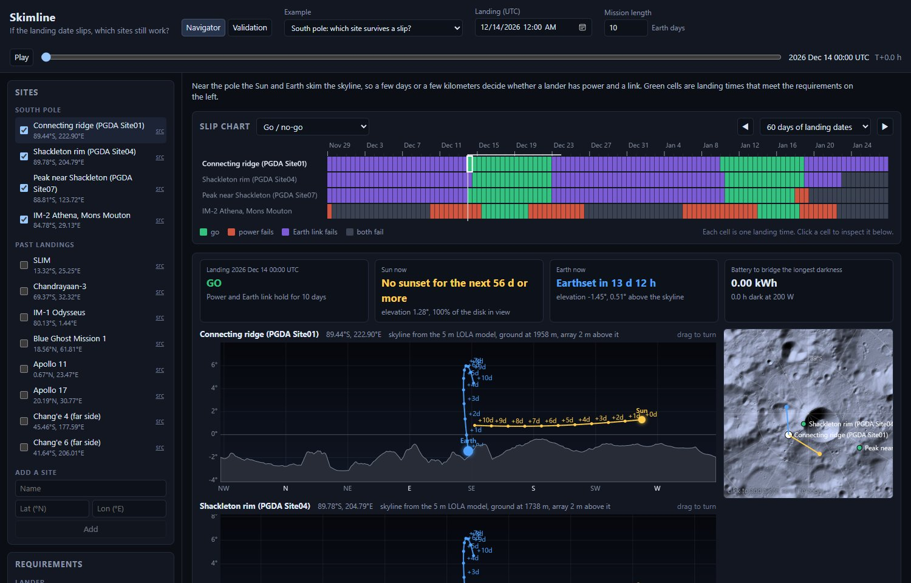

# Skimline

If the landing date slips, which lunar landing sites still have power and a direct link to Earth?

Built for the NASA Space Apps Challenge 2026, challenge "Lunar Landing Site Navigator". The name comes from the lunar south pole, where the Sun and the Earth both skim the skyline.

- Live: https://atamol.github.io/Skimline/
- Demo slides: https://atamol.github.io/Skimline/demo.pdf (Japanese: https://atamol.github.io/Skimline/demo-ja.pdf)



## What it does

- **Slip chart**: sites down the side, landing dates across. Each cell is one landing time, colored by go / no-go, hours of power after landing, share of the mission with power or an Earth link, or the longest darkness. Click a cell to inspect it.
- **Sky panorama**: the skyline seen from the site with the paths of the Sun and Earth over the mission, plus countdowns to sunset and Earthset. Two sites can be stacked for the same moment.
- **Mission timeline**: power and Earth visibility as bars, one row per site, with a scrubber and playback.
- **Requirements**: mission length, array height, array type and pointing, how long the battery can bridge darkness, how much link time is needed. The verdict and the battery size needed for the longest dark gap follow from these.
- **Map**: shaded relief south of 84°S. Click anywhere to add a site.
- **Examples**: south pole candidates, SLIM (January 2024), Blue Ghost Mission 1 (March 2025), Chang'e 4 on the far side.

## How it works

Everything runs in the browser from static files, with no server.

- **Sun and Earth**: hourly positions in the Moon-fixed frame (MOON_ME) for 2023 to 2035, taken from JPL Horizons ahead of time. Azimuth and elevation at a site are computed from those vectors, including the parallax of the Earth.
- **Skyline**: south of 82°S the skyline comes from LRO LOLA elevation models. From the site, rays march outward along great circles for 300 km and keep the highest elevation angle per 0.25° of azimuth. Positions are handled in 3D, so the curvature of the Moon is included. The three listed polar sites use the 5 m model. Any other point is computed on the fly in a Web Worker from 40 m, 80 m and 320 m tiles. North of 82°S the horizon is a smooth sphere.
- **Power**: the share of the Sun's disk above the skyline times the cosine of the angle on the array (tracking, flat, or fixed at a given azimuth and tilt).
- **Earth link**: the Earth's center has to clear the skyline by a chosen margin.

## Checks

The Validation tab in the app shows these with their sources. `npx tsx tools/validate.ts` rebuilds the numbers.

| Check | Result |
|---|---|
| Azimuth and elevation against JPL Horizons, 264 samples at 12 sites | largest error 0.006° |
| Blue Ghost Mission 1, landing to sunset | 348 h computed, 346 h of daylight operations reported |
| SLIM with a west-facing array | no power at landing, light returns Jan 23, half output Jan 26, operations resumed Jan 28 |
| Chang'e 4 | Earth never above -37° |
| 40 m tiles against the 5 m model, skyline | mean difference 0.07° to 0.16° |
| Connecting ridge, mean share of the Sun in view, 2027 | 85% (Noda et al. 2008 report 86% for the best-lit south pole surface) |

## Run it

```bash
npm install
```

```bash
npm run dev
```

```bash
npm test
```

## Rebuild the data

The files under `public/data` are checked in, so this is only needed to change them. The elevation GeoTIFFs go in `data/raw` (URLs in [docs/sources.md](docs/sources.md)).

| Command | Output |
|---|---|
| `npx tsx tools/fetch-ephemeris.ts` | `public/data/ephem`, Sun and Earth vectors from Horizons |
| `npx tsx tools/build-tiles.ts` | `public/data/dem`, elevation tiles |
| `npx tsx tools/build-map.ts` | `public/data/map`, shaded relief |
| `npx tsx tools/site-summits.ts` | places the polar sites on the local high point |
| `npx tsx tools/build-horizons.ts` | `public/data/horizons.json`, skylines from the 5 m model |
| `npx tsx tools/fetch-horizons-fixture.ts` | reference azimuths and elevations for the geometry test |
| `npx tsx tools/validate.ts` | `public/data/validation.json` |

## Slides

The decks are in `slides/` (Slidev): `slides.md` in Japanese and `slides.en.md` in English. After `npm install` there, `npm run dev` opens the Japanese deck, `npm run export` rewrites `public/demo-ja.pdf` and `npm run export:en` rewrites `public/demo.pdf`.

## Limits

- Terrain is modeled only south of 82°S.
- The 5 m LOLA model is mostly interpolated between laser tracks, so features smaller than a few tens of meters are not resolved.
- An Earth link means the Earth is above the skyline. Ground station visibility is not checked.
- Power leaves out temperature, dust and shadows cast by the lander itself.

## Data and references

Full list with URLs in [docs/sources.md](docs/sources.md).

- JPL Horizons System, NASA/JPL
- LRO LOLA south pole elevation models, NASA GSFC Planetary Geodesy Data Archive
- Barker, M. K. et al. (2021), Planetary and Space Science 203, 105119
- Mazarico, E. et al. (2011), Icarus 211, 1066-1081
- Noda, H. et al. (2008), Geophysical Research Letters 35, L24203

## License

Apache-2.0. See [LICENSE](LICENSE).

AI tools were used for coding.
