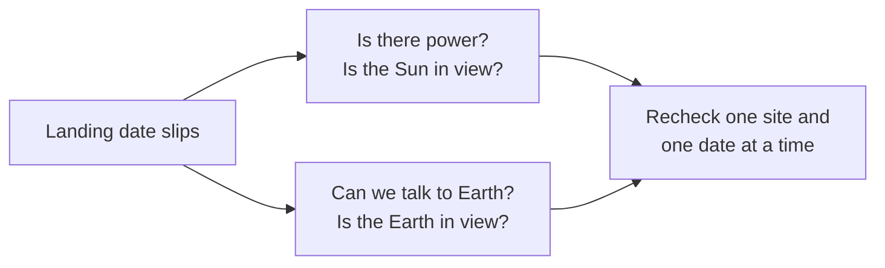
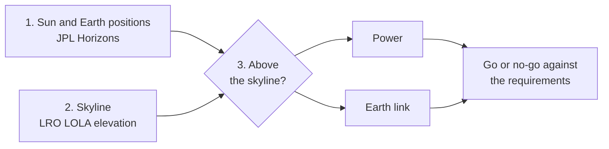

# Skimline

If the landing date slips, which sites still work?

NASA Space Apps Challenge 2026 · Lunar Landing Site Navigator · Atamol

---

## Problem: landing dates slip

- Horizons, Quickmap and Moon Trek answer one case at a time
- When the schedule moves, planners need to compare the alternatives at once

---

## Theory: the skyline decides

- Power and a direct link both need a body **above the skyline**
- At the south pole the Sun and the Earth both skim the horizon, so a few days or a few kilometers change the answer

---

## Theory: three steps to a verdict

---

## Solution: one chart of sites × landing dates

- Each cell is one landing time, green is a go
- The same ridge is a go for about ten days, then loses the Earth for two weeks

---

## Solution: the sky from the chosen cell

- Skyline with the paths of the Sun and Earth
- Countdown to sunset and Earthset
- Two sites stacked

---

## Does it hold up?

0.006°
largest difference from JPL Horizons (the Sun is 0.53° wide)

348 h
landing to sunset, Blue Ghost Mission 1 (346 h reported)

Jan 26
SLIM back to half output (operations resumed Jan 28)

85%
sunlight on the connecting ridge (KAGUYA: 86% at the best-lit surface)

- Data: NASA (JPL Horizons, LRO LOLA), JAXA (SLIM, KAGUYA)
- Not modeled: terrain north of 82°S, ground stations, temperature, dust
