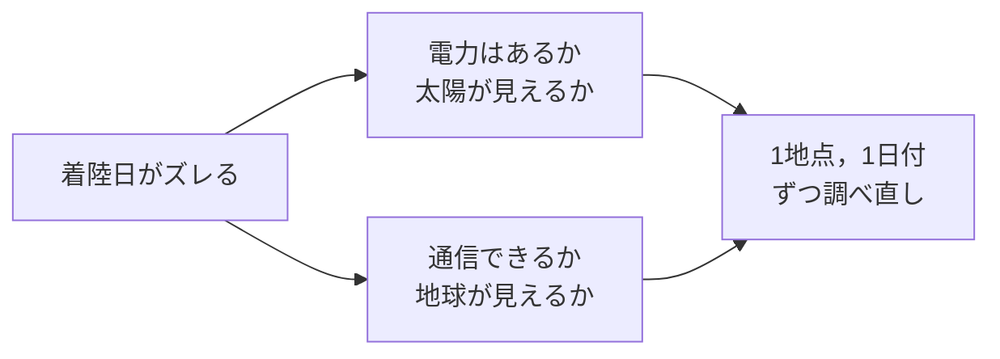
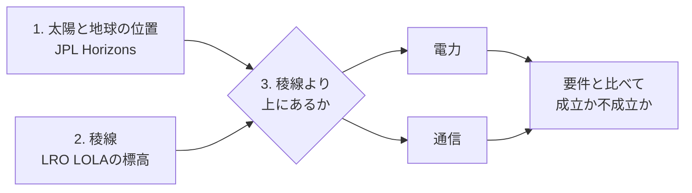

# Skimline

着陸日がズレても使える地点はどこか

NASA Space Apps Challenge 2026 · Lunar Landing Site Navigator

---

## 課題: 着陸日はズレる

- Horizons，Quickmap，Moon Trekで調べられるのは1件ずつ
- 日程が動いたら，候補をまとめて見比べたい

---

## 原理: 決め手は稜線

- 電力も通信も，天体が**稜線より上**にあるかで決まる
- 南極では太陽も地球も地平線すれすれで，数日，数kmズレるだけで結果が変わる

---

## 方法: 3段で合否を出す

---

## 解決案: 地点 × 着陸日の表

- 1マスが着陸時刻1つ分で，緑が成立
- 同じ尾根でも約10日は成立，その後2週間は地球が見えない

---

## 解決案: 選んだマスの空

- 稜線と，太陽と地球の通り道
- 日没と地球没までの残り時間
- 2地点を上下に比較

---

## 計算は合っているか

0.006度
JPL Horizonsとの最大の差 (太陽の直径は0.53度)

348時間
Blue Ghost Mission 1の日没まで (報告は346時間)

1月26日
SLIMの出力が半分に戻る日 (運用再開は1月28日)

85%
Connecting ridgeの日照率 (かぐやの観測は最良の地表で86%)

- データ: NASA (JPL Horizons，LRO LOLA)，JAXA (SLIM，かぐや)
- 未対応: 南緯82度より北の地形，地上局，温度，塵
